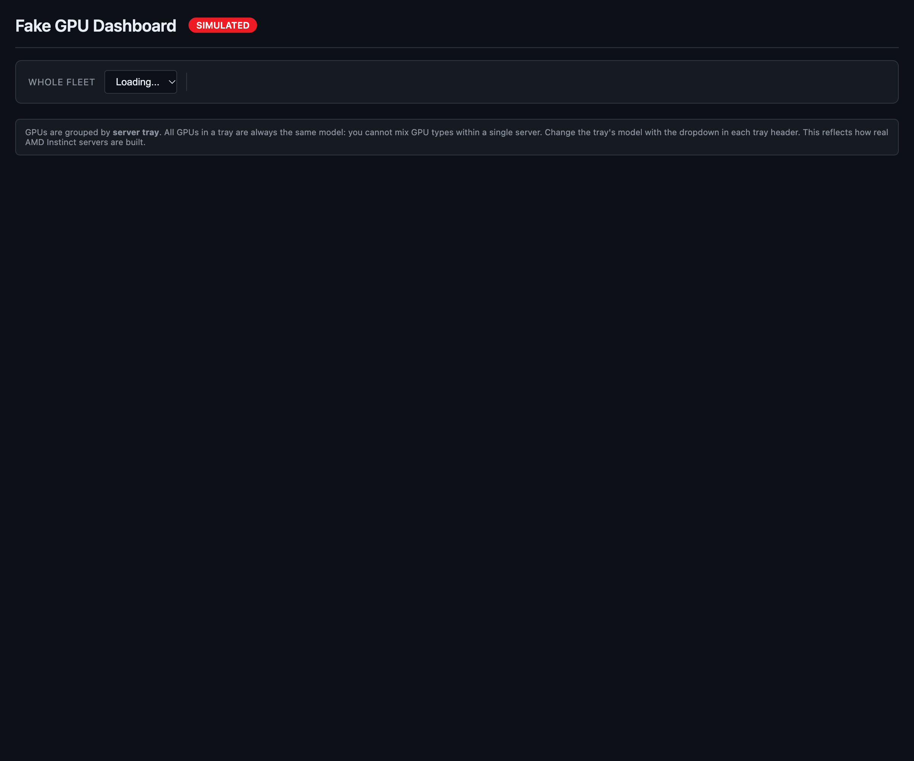

# fake-gpu

Eight AMD Instinct MI300X cards on a machine that has no GPU at all.

fake-gpu writes the files, device nodes and libraries that AMD's software
stack looks for: the KFD topology, the `amdgpu` sysfs attributes, `/dev/kfd`,
a `libamd_smi.so`, an `amd-smi`. AMD's own device plugin, DRA driver and
metrics exporter then run against it unmodified, so you can test scheduling,
monitoring and failure handling on a laptop or in CI. Nothing is computed:
there is no HIP, no VRAM behind the numbers, no ioctl that does anything.



## One minute, no cluster

```bash
docker compose -f deployments/docker/compose.yaml up -d --build
alias fgpu='docker compose -f deployments/docker/compose.yaml exec fake-gpu'

fgpu fakegpuctl busy -gpu 0 util=95
fgpu fakegpuctl busy -gpu 4 util=70
fgpu fakegpuctl throttle -gpu 1
fgpu fakegpuctl retire-page -gpu 2 count=2
fgpu fakegpuctl xgmi-down -gpu 5
fgpu fakegpuctl list
```

```text
GPU  NAME                 STATUS          TEMP  POWER  UTIL  ECC  RETIRED
0    AMD Instinct MI300X  healthy         84 C  737 W  98 %  0    0
1    AMD Instinct MI300X  throttling      40 C  78 W   7 %   0    0
2    AMD Instinct MI300X  page_retired    45 C  112 W  0 %   0    2
3    AMD Instinct MI300X  healthy         44 C  110 W  0 %   0    0
4    AMD Instinct MI300X  healthy         78 C  540 W  67 %  0    0
5    AMD Instinct MI300X  xgmi_link_down  45 C  146 W  5 %   0    0
6    AMD Instinct MI300X  healthy         46 C  148 W  6 %   0    0
7    AMD Instinct MI300X  healthy         43 C  119 W  1 %   0    0
```

That listing was taken 45 seconds after the commands. GPU 0 needs about that
long to reach 84 C, because the lag is modelled; see [telemetry](#telemetry).
The dashboard is on [localhost:8080](http://localhost:8080) and
`fgpu amd-smi monitor` prints the same state the way AMD's tool lays it out.
The container is unprivileged and leaves the host alone. Other containers read
the same cards by mounting the `state` volume at `/var/lib/fake-gpu`.

## On Kubernetes

You need kind v0.33 or newer, kubectl, Helm and Docker.

```bash
kind create cluster --name fake-gpu --image kindest/node:v1.37.0 \
    --config deployments/kind-node/kind-config.yaml

docker build -t fake-gpu:dev .
kind load docker-image fake-gpu:dev --name fake-gpu

helm install fake-gpu deployments/helm/fake-gpu -n amd-mock --create-namespace \
    --set image.repository=fake-gpu --set image.tag=dev --set image.pullPolicy=Never \
    --set dra.image.repository=docker.io/rocm/k8s-gpu-dra-driver --set dra.image.tag=v1.0.0 \
    --set monitoring.enabled=false --set metricsExporter.enabled=false
```

Give it a minute, then `kubectl get resourceslices` shows eight devices
published by AMD's DRA driver. The [DRA guide](docs/guides/dra.md) requests one
from a pod. If you would rather schedule with `amd.com/gpu`, the
[device-plugin guide](docs/guides/device-plugin.md) swaps the allocator. For
Prometheus and Grafana fed by AMD's real exporter, follow the
[telemetry guide](docs/guides/telemetry.md); it needs two more images.

`kind delete cluster --name fake-gpu` removes everything.

## Faults

Each fault is a POST to the agent. `fakegpuctl`, the dashboard buttons and
`curl -X POST 'localhost:8080/api/actions/throttle?gpu=1'` all do the same thing.

| Action | Effect |
|---|---|
| `crash` | The card's device nodes and driver binding disappear |
| `overheat` | Edge temperature sits at 105 C and the card throttles itself |
| `ecc-error` | Uncorrectable ECC count rises and `ras/fatal_error` is set |
| `throttle` | Power budget and clocks are halved |
| `retire-page` | Pages appear in `ras/gpu_vram_bad_pages` and in AMD SMI |
| `xgmi-down` | `xgmi_error` is set and the xGMI links go down on both ends |
| `busy util=N` | The card holds N percent load until told otherwise |
| `idle`, `recover` | Back to the profile defaults |

A fault shows up where the real thing would: in sysfs, through
`libamd_smi.so`, in `amd-smi`, and in Prometheus. Set `kernelLog.enabled=true`
and it also lands in the kernel log, which is off by default because kind
nodes share the host's kernel and the lines end up in your own `dmesg`.
[demo/faults](demo/faults/README.md) names the metric that carries each one.

## Telemetry

Load is the only input. Power follows utilization, temperature drifts toward
whatever that power settles at, and a card that reaches 100 C cuts its own
budget. Every second the agent rewrites the `amdgpu` attributes a monitoring
tool reads: hwmon temperatures and power, `gpu_busy_percent`,
`mem_info_vram_used`, the active level in `pp_dpm_sclk`.

AMD's GPU Agent and metrics exporter read the same state through the mock
`libamd_smi.so`, so what reaches Grafana carries AMD's metric names. Exporter
v1.5.2 has no metric for retired pages or xGMI link state. The bundled
Prometheus takes those two from the agent, as `gpu_retired_pages` and
`gpu_xgmi_link_up`.

## Profiles

`--set gpu.profile=<name>` picks the card. Profiles are YAML files in
`profiles/`, described in [docs/profiles.md](docs/profiles.md).

| Profile | Card | Memory | TDP |
|---|---|---|---|
| `mi210` | Instinct MI210 | 64 GB | 300 W |
| `mi250x` | Instinct MI250X, 16 devices | 64 GB each | 500 W |
| `mi300a` | Instinct MI300A | 128 GB | 550 W |
| `mi300x` | Instinct MI300X, the default | 192 GB | 750 W |
| `mi325x` | Instinct MI325X | 256 GB | 1000 W |
| `mi350x` | Instinct MI350X | 288 GB | 1000 W |
| `mi355x` | Instinct MI355X | 288 GB | 1400 W |

An MI300X can also start split in two with `--set gpu.partition=DPX`, which
gives sixteen schedulable 96 GB devices;
[partition allocation](docs/guides/partition-allocation.md) covers it.

### Your own card

If you have an AMD GPU, describe it instead of picking from the list:

```bash
go run ./cmd/capture-profile --name "AMD Radeon RX 9070 XT" -o rx9070xt.yaml
node-agent --config rx9070xt.yaml --profiles profiles
```

`capture-profile` reads the `amdgpu` sysfs tree without root and writes a
profile for the card with the most VRAM. Anything it could not read is listed
at the top of the file. A suspended card hides its power caps and sensors, so
run it while the GPU is awake. Serial-like IDs are replaced unless you pass
`--keep-ids`.

## What is in the image

`node-agent` renders the tree and serves the API and dashboard. `amd-smi` and
`rocm-smi` print a subset of the real tools' output from the same state.
`fakegpuctl` drives the faults. `libamd_smi.so` implements the calls AMD's GPU
Agent makes and returns `NOT_SUPPORTED` for the rest.

## Where it stops

A workload that opens `/dev/kfd` and expects a driver gets nothing back. The
sysfs attributes are read-only, so writing a power cap changes nothing. The
`amd-smi` output is shaped like the real tool's but is not byte-compatible.
Partition changes made through the dashboard are display state and do not
change what Kubernetes can schedule.
[Simulation depth by area](docs/simulation-depth.md) goes through every
surface and names the test that guards it.

## Tests

```bash
go test ./...            # unit and contract tests
tests/docker/run.sh      # the Docker mode above, end to end
```

The cluster suites run AMD's device plugin and DRA driver against all seven
profiles and AMD's exporter against the MI300X.
[docs/guides/testing.md](docs/guides/testing.md) lists them with their
prerequisites.

## License

GNU Affero General Public License v3.0, see [LICENSE](LICENSE). Parts of the
code were first released by third parties under the Apache License 2.0 and stay
available under it; [NOTICE](NOTICE) has the details.
