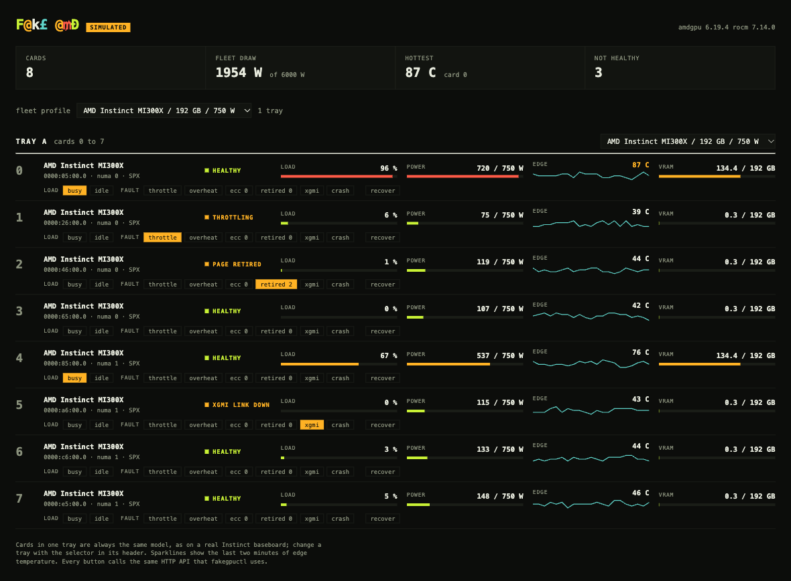

<p align="center">
  
</p>

fake-gpu puts eight AMD Instinct MI300X cards on a machine that has no GPU at all.

fake-gpu writes the files, device nodes and libraries that AMD's software
stack looks for: the KFD topology, the `amdgpu` sysfs attributes, `/dev/kfd`,
a `libamd_smi.so`, an `amd-smi`. AMD's own device plugin, DRA driver and
metrics exporter then run against it unmodified, so you can test scheduling,
monitoring and failure handling on a laptop or in CI. Nothing is computed:
there is no HIP, no VRAM behind the numbers, no ioctl that does anything.



## One minute, no cluster

```bash
docker compose -f deploy/docker/compose.yaml up -d --build
alias fgpu='docker compose -f deploy/docker/compose.yaml exec fake-gpu'

fgpu fakegpuctl busy -gpu 0 util=95
fgpu fakegpuctl busy -gpu 4 util=70
fgpu fakegpuctl throttle -gpu 1
fgpu fakegpuctl retire-page -gpu 2 count=2
fgpu fakegpuctl xgmi-down -gpu 5
fgpu fakegpuctl list
```

```text
GPU  NAME                 STATUS          TEMP  POWER  UTIL  ECC  RETIRED
0    AMD Instinct MI300X  healthy         84 C  737 W  98 %  0    0
1    AMD Instinct MI300X  throttling      40 C  78 W   7 %   0    0
2    AMD Instinct MI300X  page_retired    45 C  112 W  0 %   0    2
3    AMD Instinct MI300X  healthy         44 C  110 W  0 %   0    0
4    AMD Instinct MI300X  healthy         78 C  540 W  67 %  0    0
5    AMD Instinct MI300X  xgmi_link_down  45 C  146 W  5 %   0    0
6    AMD Instinct MI300X  healthy         46 C  148 W  6 %   0    0
7    AMD Instinct MI300X  healthy         43 C  119 W  1 %   0    0
```

That listing was taken 45 seconds after the commands. GPU 0 needs about that
long to reach 84 C, because the lag is modelled; see [telemetry](#telemetry).
The console above is on [localhost:8080](http://localhost:8080) and
`fgpu amd-smi monitor` prints the same state the way AMD's tool lays it out.
The container is unprivileged and leaves the host alone. Other containers read
the same cards by mounting the `state` volume at `/var/lib/fake-gpu`.

## On Kubernetes

You need kind v0.33 or newer, kubectl, Helm and Docker.

```bash
kind create cluster --name fake-gpu --image kindest/node:v1.37.0 \
    --config deploy/kind-node/kind-config.yaml

docker build -t fake-gpu:dev .
kind load docker-image fake-gpu:dev --name fake-gpu

helm install fake-gpu charts/fake-gpu -n amd-mock --create-namespace \
    --set image.repository=fake-gpu --set image.tag=dev --set image.pullPolicy=Never \
    --set dra.image.repository=docker.io/rocm/k8s-gpu-dra-driver --set dra.image.tag=v1.0.0 \
    --set monitoring.enabled=false --set metricsExporter.enabled=false
```

Give it a minute, then `kubectl get resourceslices` shows eight devices
published by AMD's DRA driver. The [DRA guide](docs/guides/dra.md) requests one
from a pod. If you would rather schedule with `amd.com/gpu`, the
[device-plugin guide](docs/guides/device-plugin.md) swaps the allocator. For
Prometheus and Grafana fed by AMD's real exporter, follow the
[telemetry guide](docs/guides/telemetry.md); it needs two more images.

`kind delete cluster --name fake-gpu` removes everything.

## Faults

Each fault is a POST to the agent. `fakegpuctl`, the dashboard buttons and
`curl -X POST 'localhost:8080/api/actions/throttle?gpu=1'` all do the same thing.

| Action | Effect |
|---|---|
| `crash` | The card's device nodes and driver binding disappear |
| `overheat` | Edge temperature sits at 105 C and the card throttles itself |
| `ecc-error` | Uncorrectable ECC count rises and `ras/fatal_error` is set |
| `throttle` | Power budget and clocks are halved |
| `retire-page` | Pages appear in `ras/gpu_vram_bad_pages` and in AMD SMI |
| `xgmi-down` | `xgmi_error` is set and the xGMI links go down on both ends |
| `busy util=N` | The card holds N percent load until told otherwise |
| `idle`, `recover` | Back to the profile defaults |

A fault shows up where the real thing would: in sysfs, through
`libamd_smi.so`, in `amd-smi`, and in Prometheus. Set `kernelLog.enabled=true`
and it also lands in the kernel log, which is off by default because kind
nodes share the host's kernel and the lines end up in your own `dmesg`.
[demo/faults](demo/faults/README.md) names the metric that carries each one.

### Scripted scenarios

A scenario file lists faults against a clock and what should be true after
each one. `fakegpuctl run` plays it and exits non-zero when a check fails, so a
CI job can assert that an alert rule or a remediation controller reacted.

```yaml
name: thermal runaway on card 0
steps:
  - at: 0s
    gpu: 0
    do: busy
    args: {util: "100"}
    expect: {utilization_pct: ">= 95", power_w: ">= 600"}
  - at: 70s
    gpu: 0
    do: overheat
    expect: {status: overheating, throttled: "true", clock_gfx_mhz: "< 1200"}
```

```text
$ fakegpuctl run examples/scenarios/thermal-runaway.yaml
scenario: thermal runaway on card 0 (4 steps)
[   0.0s] gpu 0 busy -> healthy
[   0.0s] gpu 0 ok: power_w >= 600, utilization_pct >= 95
[  10.0s] gpu 0 ok: temperature_c >= 60
[  70.0s] gpu 0 overheat -> overheating
[  70.0s] gpu 0 ok: clock_gfx_mhz < 1200, status overheating, throttled true
[  85.0s] gpu 0 recover -> healthy
[  85.0s] gpu 0 ok: status healthy, throttled false, utilization_pct < 8
scenario passed in 85.0s
```

`expect` reads any field the API returns for a card and waits up to `within`
(30 seconds unless set) for it to hold. [examples/scenarios](examples/scenarios)
has this one and an xGMI link flap.

## Telemetry

Load is the only input. Power follows utilization, temperature drifts toward
whatever that power settles at, and a card that reaches 100 C cuts its own
budget. Every second the agent rewrites the `amdgpu` attributes a monitoring
tool reads: hwmon temperatures and power, `gpu_busy_percent`,
`mem_info_vram_used`, the active level in `pp_dpm_sclk`.

AMD's GPU Agent and metrics exporter read the same state through the mock
`libamd_smi.so`, so what reaches Grafana carries AMD's metric names. Exporter
v1.5.2 has no metric for retired pages or xGMI link state. The bundled
Prometheus takes those two from the agent, as `gpu_retired_pages` and
`gpu_xgmi_link_up`.

## HIP memory

`libfakehip.so` implements the device and memory half of the HIP runtime:
`hipGetDeviceCount`, `hipSetDevice`, `hipMalloc`, `hipFree`, `hipMemcpy`,
`hipMemGetInfo` and their neighbours, with the real error codes. A program
that only allocates and copies builds against `fakehip.h` and runs here:

```c
#include <fakehip.h>

void *weights;
if (hipMalloc(&weights, (size_t)64 << 30) == hipErrorOutOfMemory)
    /* your out-of-memory path, testable without a GPU */;
```

Device memory is host memory mapped without reservation, so 64 GiB costs
nothing until it is written. The limit is the card's VRAM from the profile, and
`HIP_VISIBLE_DEVICES` narrows the cards as it does on real hardware. What a
process holds is added to the VRAM the agent reports, so it shows in
`amd-smi`, in sysfs and in Grafana, and it is released when the process exits
or is killed. The agent stages the library and header under
`/var/lib/fake-gpu/driver/usr/` for other containers to build against.

It does not run kernels. A program that calls `hipLaunchKernel` or is linked
against the real `libamdhip64` will not load against it.

### Running real kernels

Kernels can still run, on the CPU. [examples/hip-cpu](examples/hip-cpu) builds
a HIP program against the HIP CPU Runtime and starts it with

```bash
fakegpuctl exec -gpu 0 util=90 -- saxpy 16777216 400
```

`exec` keeps the card busy while the command runs, returns its exit code and
sets the card idle afterwards. It works for any command, so a CPU stand-in for
a training job shows up as GPU load in whatever is watching.

## Profiles

`--set gpu.profile=<name>` picks the card. Profiles are YAML files in
`profiles/`, described in [docs/profiles.md](docs/reference/profiles.md).

| Profile | Card | Memory | TDP |
|---|---|---|---|
| `mi210` | Instinct MI210 | 64 GB | 300 W |
| `mi250x` | Instinct MI250X, 16 devices | 64 GB each | 500 W |
| `mi300a` | Instinct MI300A | 128 GB | 550 W |
| `mi300x` | Instinct MI300X, the default | 192 GB | 750 W |
| `mi325x` | Instinct MI325X | 256 GB | 1000 W |
| `mi350x` | Instinct MI350X | 288 GB | 1000 W |
| `mi355x` | Instinct MI355X | 288 GB | 1400 W |

An MI300X can also start split in two with `--set gpu.partition=DPX`, which
gives sixteen schedulable 96 GB devices;
[partition allocation](docs/guides/partition-allocation.md) covers it.

### Your own card

If you have an AMD GPU, describe it instead of picking from the list:

```bash
go run ./cmd/capture-profile --name "AMD Radeon RX 9070 XT" -o rx9070xt.yaml
node-agent --config rx9070xt.yaml --profiles profiles
```

`capture-profile` reads the `amdgpu` sysfs tree without root and writes a
profile for the card with the most VRAM;
[examples/captured/rx9070xt.yaml](examples/captured/rx9070xt.yaml) is what it
produced on a real one. Anything it could not read is listed
at the top of the file. A suspended card hides its power caps and sensors, so
run it while the GPU is awake. Serial-like IDs are replaced unless you pass
`--keep-ids`.

## What is in the image

`node-agent` renders the tree and serves the API and dashboard. `amd-smi` and
`rocm-smi` print a subset of the real tools' output from the same state.
`fakegpuctl` drives the faults. `libamd_smi.so` implements the calls AMD's GPU
Agent makes and returns `NOT_SUPPORTED` for the rest.

## Where it stops

A workload that opens `/dev/kfd` and expects a driver gets nothing back. The
sysfs attributes are read-only, so writing a power cap changes nothing. The
`amd-smi` output is shaped like the real tool's but is not byte-compatible.
Partition changes made through the dashboard are display state and do not
change what Kubernetes can schedule.
[Simulation depth by area](docs/reference/simulation-depth.md) goes through every
surface and names the test that guards it.

## Repository layout

| Path | Contents |
| --- | --- |
| `cmd/`, `pkg/` | Go: node agent, `amd-smi`, `fakegpuctl`, NRI plugin, renderer, AMD SMI and HIP mocks |
| `charts/fake-gpu/` | Helm chart, templates grouped by component (agent, device plugin, metrics exporter, monitoring) |
| `deploy/` | Docker compose, kind node image, DRA driver image and filter, metrics exporter image, CUSE driver image, example workloads |
| `profiles/` | GPU profiles shared by the image and the chart |
| `test/` | `lib/` shared helpers, `chart/` render-only checks, `container/` Docker checks, `e2e/` cluster suites |
| `docs/` | Guides, reference and contributor pages |
| `demo/` | Presenter walkthroughs |
| `scripts/` | Image and chart builds, docs site, link and chart snapshot checks |

## Tests

```bash
go test ./...                    # unit and contract tests
test/chart/run.sh                # chart render contracts, needs only helm
test/container/docker/run.sh     # the Docker mode above, end to end
```

The cluster suites under `test/e2e/` run AMD's device plugin and DRA driver
against all seven profiles and AMD's exporter against the MI300X.
[Testing](docs/contributing/testing.md) lists every check with its
prerequisites and the CI workflow that runs it.

## License

GNU Affero General Public License v3.0, see [LICENSE](LICENSE). Parts of the
code were first released by third parties under the Apache License 2.0 and stay
available under it; [NOTICE](NOTICE) has the details.
