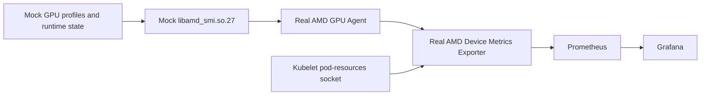

# AMD Device Metrics Exporter telemetry

This guide runs the real AMD Device Metrics Exporter and GPU Agent against the
mock GPUs and feeds Prometheus and Grafana. It proves that mock GPU state and
dashboard fault actions reach AMD's exporter metrics, Prometheus and the
Grafana dashboard, with workload labels from kubelet.

## Overview

- **Real, unmodified:** the AMD Device Metrics Exporter and GPU Agent from AMD
  release v1.5.2, kubelet's pod-resources socket, and standard upstream
  Prometheus and Grafana.
- **Mocked:** the AMD SMI device library (`libamd_smi.so.27`) that GPU Agent
  calls. The mock replaces the exporter's AMD SMI dependency.



This follows the same principle as [NVIDIA Moka](https://github.com/NVIDIA/k8s-test-infra):
simulate the vendor device interface and keep its consumers real. NVIDIA DCGM
Exporter obtains telemetry through DCGM; AMD's exporter talks to GPU Agent,
which invokes AMD SMI. These are different implementations, rather than
interchangeable libraries.

Chart 0.1.0 installs the real exporter, a built-in Prometheus and a built-in
Grafana by default; it does not need Prometheus Operator CRDs. Choose the
[optional external stack](#5-optional-use-an-external-prometheus-operator-stack)
only to integrate with kube-prometheus-stack. Allocation itself is covered by
the [DRA](dra.md) and [device-plugin](device-plugin.md) guides.

## Requirements

- kind v0.33.0 or newer, kubectl v1.37, Helm, Python 3 and a running Docker or
  Podman runtime.
- Linux AMD64 or ARM64 nodes. Images support both. AMD's published collector
  binaries are x86-64, so the ARM64 runtime executes them under QEMU.
- The shared kind configuration (`deploy/kind-node/kind-config.yaml`, or the
  one `demo/setup.sh` renders), which maps the mock dashboard to host port 8080
  and Grafana to host port 3000. Mappings are fixed at cluster creation.
- End users need no compiler, AMD checkout or custom image build. The published
  inputs are:

| Component | Version |
| --- | --- |
| Mock node agent | `ghcr.io/mesutoezdil/fake-gpu:v0.1.0` |
| AMD collector with mock SMI backend | `ghcr.io/mesutoezdil/amd-device-metrics-exporter:v1.5.2-fake.1` |
| Mock Helm chart | `0.1.0` |
| Existing Kubernetes node image | `ghcr.io/mesutoezdil/amd-mock-kind-node:0.1.0` |

## Steps

### 1. Install the mock with default monitoring

For a complete published-image setup and a single file controlling dashboard
ports and enable switches, use [the demo setup](../../demo/README.md):

```bash
./demo/setup.sh
```

The default chart installs the real AMD exporter, Prometheus and Grafana. No
port-forward or separate monitoring installation is required. The plain kind
file controls mappings only; use `demo/config.yaml` with `demo/setup.sh` to
coordinate mappings and workloads. Existing kind mappings cannot change on a
Helm upgrade.

These chart values remove parts of the stack:

| Value | Effect |
| --- | --- |
| `monitoring.grafana.enabled=false` | Omits Grafana. |
| `monitoring.enabled=false` | Omits both built-in monitoring applications. |
| `dashboard.enabled=false` | Removes the mock dashboard's host exposure. |
| `metricsExporter.enabled=false` | Omits the exporter; also requires `monitoring.enabled=false`. |

### 2. Open the Grafana dashboard

Open `http://localhost:3000`, sign in with `admin` / `amdmock` and open
**AMD GPU Fleet: Device Metrics Exporter**. The dashboard refreshes every
5 seconds. Exporter collection and Prometheus scraping add a short delay
before dashboard actions appear in the graphs.

### 3. Inject an ECC error from the dashboard

Open the mock dashboard at `http://localhost:8080` and use the ECC error
control for a GPU. The control toggles the simulated uncorrectable ECC fault;
use it again to clear the fault. No separate injection command is required.
The control posts to the node agent's action endpoint, which can also be
called directly:

```bash
curl -X POST 'http://localhost:8080/api/actions/ecc-error?gpu=0'
```

The uncorrectable ECC panel in Grafana rises after collection and scraping.
The other per-GPU buttons are listed under
[Other dashboard actions](#other-dashboard-actions).

### 4. Query the exporter metrics

Forward the built-in Prometheus (Grafana is already exposed on port 3000):

```bash
kubectl -n amd-mock port-forward svc/fake-gpu-prometheus 9090:9090
```

The `amd_` prefix is configured explicitly. Representative queries:

```promql
amd_gpu_nodes_total
amd_gpu_edge_temperature
amd_gpu_package_power
amd_gpu_gfx_activity
amd_gpu_total_vram
amd_gpu_used_vram
amd_gpu_ecc_uncorrect_total
```

To read the exporter directly:

```bash
kubectl -n amd-mock port-forward svc/fake-gpu-metrics-exporter 5000:5000
curl http://localhost:5000/metrics
```

### 5. (Optional) Use an external Prometheus Operator stack

For kube-prometheus-stack integration instead of the built-in applications:

```bash
./scripts/setup-monitoring.sh
kubectl -n monitoring port-forward svc/monitoring-grafana 3000:80
```

The script preserves your profile and allocator settings, disables bundled
monitoring, enables the exporter ServiceMonitor, installs pinned
kube-prometheus-stack chart 92.0.0, and provisions the same dashboard. It does
not scrape the mock agent's `/metrics` endpoint. If host port 3000 is already
in use, choose another port for this optional port-forward. Set
`GRAFANA_ADMIN_PASSWORD` to select an external Grafana password.

## Verify

- `kubectl -n amd-mock logs daemonset/fake-gpu-metrics-exporter` contains
  `AMD SMI ABI 27 backend initialized`, which confirms the replacement library
  loaded.
- In Prometheus, the exporter target is `UP`.
- `amd_gpu_nodes_total` and the per-GPU series report the profile's GPUs, and
  `amd_gpu_ecc_uncorrect_total` increases after step 3 and resets when the
  fault is toggled off.

The automated checks:

```bash
./test/container/smi_abi/run.sh # Podman; CONTAINER_RUNTIME=docker also supported
# Default chart: Grafana is already exposed on port 3000.
kubectl -n amd-mock port-forward svc/fake-gpu-prometheus 9090:9090
python3 test/e2e/telemetry/pipeline.py
ALLOCATOR=dra python3 test/e2e/telemetry/attribution.py
# Or ALLOCATOR=device-plugin on that installation.
```

`test/container/smi_abi/run.sh` checks structure compatibility, units,
enumeration, buffer bounds, ECC, graphics clocks, unsupported APIs and
concurrent calls. `test/e2e/telemetry/pipeline.py` checks GPU identities and
values, VRAM units, target health, every per-GPU dashboard action including
ECC injection and recovery, Grafana provisioning and every dashboard query.
`test/e2e/telemetry/attribution.py` checks pod, namespace and container labels
from the kubelet pod-resources socket. The integration test invokes the same
dashboard action endpoints, waits for the ECC count to increase in Prometheus,
toggles the fault off, and verifies recovery. This validates the action's
backend and telemetry pathway; it does not automate a browser click.
Allocation lifecycle tests remain in the DRA and device-plugin suites. See
[testing](../contributing/testing.md#telemetry) for the run conditions and CI
coverage.

## How it works

### Device state and ABI

The node agent writes atomic per-GPU snapshots beneath
`/var/lib/fake-gpu/smi`. Profiles, runtime changes and fault injection update
this same state. The AMD SMI library reads it when AMD's GPU Agent requests
device telemetry. It does not construct Prometheus responses or substitute the
GPU Agent RPC service.

The replacement is compiled against the unmodified AMD SMI header in GPU Agent
release-v1.5.2. Its backend uses official ABI 27 types, and the same library
is installed for every consumer. Header provenance is recorded in
`pkg/mocksmi/UPSTREAM.md`; unsupported capabilities return AMD's
`AMDSMI_STATUS_NOT_SUPPORTED`.

Temperature APIs return millidegrees Celsius; the exporter presents Celsius.
Memory-total/usage APIs return bytes, while AMD VRAM-info/usage structures use
MiB. Power information uses watts; power-cap information uses microwatts. The
dashboard converts the exporter's MiB VRAM values to bytes for display.

Human-readable profile IDs are converted into stable canonical hexadecimal
UUIDs for AMD GPU Agent. GPU identity comes from the same profile PCI BDFs and
DRM card/render indices used for allocation. The exporter mounts mock sysfs and
kubelet's real pod-resources socket to associate metrics with scheduled
consumers. Its read-only state mount keeps telemetry collection separate from
fault injection.

### ECC action path

The dashboard posts to `/api/actions/ecc-error?gpu=N`. The node agent updates
that GPU's shared state, AMD SMI exposes the error to the real GPU Agent, and
the exporter publishes `amd_gpu_ecc_uncorrect_total`. Prometheus and Grafana
reflect the change after collection and scraping. Clearing a simulated fault
resets its mock count; this is a simulation control, not hardware repair.

### Other dashboard actions

The six per-GPU buttons use the same state bridge:

| Action | Observable exporter values |
| --- | --- |
| Overheat | Edge temperature becomes 105°C by default; junction and memory temperatures follow the mock's offsets. |
| Busy | GPU activity, power, used VRAM and graphics clock increase. |
| Idle | Used VRAM returns to the profile baseline and activity returns to idle. |
| Crash | Power, activity and clocks become zero. |
| Recover | Profile defaults and healthy status are restored, then normal dynamic simulation resumes. |
| ECC Error | Uncorrectable ECC count increases; toggling again clears it. |

Dynamic simulation varies healthy temperature, power, clocks and utilization
each second. Prometheus collection and scraping introduce a delay; the
dashboard reads the node agent directly. Fault status text is not itself an
exported AMD metric. Crash currently changes device readings rather than making
AMD SMI return a device-lost error. Health-service events, automatic
remediation and alert rules are not enabled by this monitoring setup.

Fleet profile changes re-render the device state, but changes in GPU count
require collector reinitialization. Per-tray profile switching does not yet
perform the same immediate renderer synchronization, so it is not covered by
the fault-action guarantee.

### Built-in monitoring

The built-in Prometheus discovers every exporter endpoint through a headless
Service and DNS discovery; it does not need Prometheus Operator CRDs. GPU
consumer labels are preserved. Storage is ephemeral and retention is 24 hours.
Grafana requests 256 MiB and has a 1 GiB memory limit to support the live
dashboard.

Exporter readiness defaults to a five-second HTTP timeout, accommodating CPU
emulation. Set `metricsExporter.readinessTimeoutSeconds` to change it. This
controls Kubernetes readiness, not the Prometheus scrape interval.

### External monitoring stack

The optional external monitoring values use upstream GHCR Prometheus Operator
images and upstream Docker Hub Prometheus/Grafana images. They avoid depending
on locally cached images or Quay connectivity. Host node-exporter, Alertmanager
and kube-state-metrics are omitted from this GPU-focused setup.

### Agent restarts and upgrades

Chart `0.1.0` / mock image `v0.1.0` preserves the mounted `sys` and `smi`
directories across graceful agent restarts and reconciles stale GPU inventory
in place. This prevents the exporter from retaining mounts to deleted state.
Fresh installs need no extra commands; upgrades from an older affected agent
need one exporter restart (see [Troubleshooting](#troubleshooting)).

### Architectures and builds

The GPU Agent and exporter binaries are unchanged; ARM64 collector execution is
emulated with QEMU, while the mock node agent, Kubernetes, Prometheus and
Grafana run natively. This costs more CPU than a native collector.

Maintainers build and publish both architectures and the chart with:

```bash
./scripts/build-telemetry-images.sh --push
```

### Limits

ASIC metadata, PCIe limits and clock ranges currently use MI300X constants;
the live telemetry matrix uses the default MI300X profile. Other profiles are
validated for allocation discovery, not complete exporter metadata fidelity.

This is simulated device telemetry. It does not demonstrate GPU computation,
actual power draw, kernel driver behavior, or complete support for AMD SMI's
control and profiler APIs.

## Troubleshooting

| Symptom | Cause | Fix |
| --- | --- | --- |
| A Grafana panel is empty | The metric is missing or lacks the `amd_` prefix | Check the metric's existence and its `amd_` prefix before changing the panel query. |
| No `AMD SMI ABI 27 backend initialized` log | The replacement library did not load | Read the exporter logs and `/var/log/exporter.log` (commands below). |
| Exporter target is not `UP` in Prometheus | Exporter pod not ready or not scraped | Check the exporter pods and logs (commands below). |
| A dashboard action does not show in Grafana yet | Exporter collection and Prometheus scraping delay | Wait for the next refresh; the mock dashboard reads the node agent directly. |
| Exporter not ready under CPU emulation | Five-second readiness timeout | Raise `metricsExporter.readinessTimeoutSeconds`. |
| Host port 3000 is in use for the external stack's port-forward | Another process holds the port | Choose another local port for that optional port-forward. |
| Exporter shows stale state after upgrading from an older agent | The older agent did not preserve the mounted `sys` and `smi` directories | Refresh the exporter's mounts once, as below. |

Diagnostics:

```bash
kubectl -n amd-mock get pods -l app.kubernetes.io/name=fake-gpu-metrics-exporter
kubectl -n amd-mock logs daemonset/fake-gpu-metrics-exporter
kubectl -n amd-mock exec daemonset/fake-gpu-metrics-exporter -- \
  cat /var/log/exporter.log
```

If upgrading from an older affected agent, refresh the exporter's mounts once
the new agent has completed its rollout:

```bash
kubectl -n amd-mock rollout status ds/fake-gpu --timeout=180s
kubectl -n amd-mock rollout restart ds/fake-gpu-metrics-exporter
kubectl -n amd-mock rollout status ds/fake-gpu-metrics-exporter --timeout=180s
```

## Clean up

Remove the demo cluster created by `demo/setup.sh`, including its labelled
demo namespaces:

```bash
./demo/setup.sh --teardown
```

## Related

- [Testing: telemetry](../contributing/testing.md#telemetry)
- [Demo setup and presenter guide](../../demo/README.md)
- [DRA guide](dra.md) and [device-plugin guide](device-plugin.md)
- [Architecture](../reference/architecture.md)
- [AMD exporter source](https://github.com/ROCm/device-metrics-exporter/tree/v1.5.2)
- [AMD GPU Agent](https://github.com/ROCm/gpu-agent)
- [AMD Prometheus/Grafana integration](https://instinct.docs.amd.com/projects/device-metrics-exporter/en/release-v1.5.2/integrations/prometheus-grafana.html)
- [NVIDIA DCGM Exporter](https://docs.nvidia.com/datacenter/dcgm/latest/reference/command-line-reference/dcgm-exporter.html)
